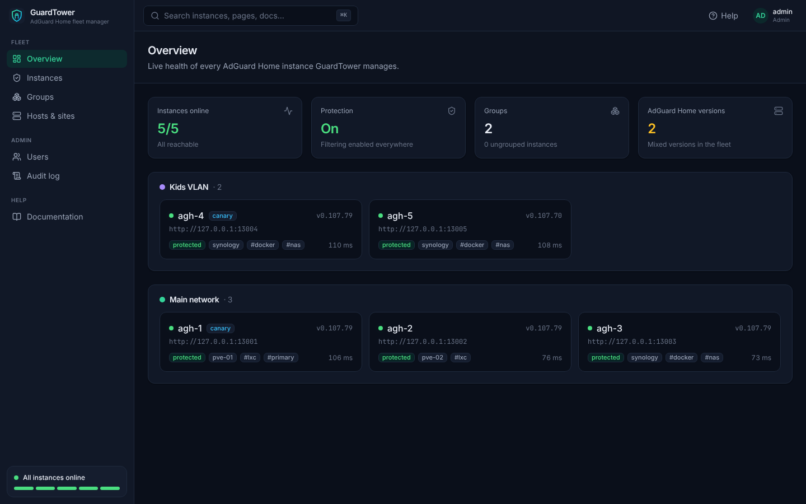

<p align="center">
  
</p>

<h1 align="center">GuardTower</h1>

<p align="center">
  <strong>The fleet manager for AdGuard Home.</strong><br>
  Monitor, configure and upgrade every AdGuard Home server from one place: safely.
</p>

<p align="center">
  <a href="https://github.com/hurseyc/GuardTower/actions/workflows/ci.yml"></a>
  <a href="https://github.com/hurseyc/GuardTower/releases"></a>
  <a href="LICENSE"></a>
</p>

<p align="center">
  
</p>

---

Running more than one AdGuard Home for redundancy, or separate instances for different VLANs, means editing settings in several places, checking several dashboards and upgrading each server by hand. GuardTower makes them one fleet.

## Highlights

- **Groups with different settings.** Base settings are shared by everyone, each *group* layers its own on top (for example *Main network* vs *Kids VLAN*), and individual instances can override the rare exception.
- **Safe changes.** Every change is a reviewable plan, rolled out canary-first with a DNS health check and **automatic rollback**. A snapshot is taken before every apply.
- **Live fleet health.** Status, versions, protection state and latency for every instance, pushed to the browser in real time.
- **Single-point-of-failure warnings.** GuardTower knows which host, power domain and site each instance runs on, and warns when a group's "redundant" servers would fail together.
- **Built-in wiki.** Setup, operation and admin docs ship inside the app, with contextual help on every screen (<kbd>?</kbd>) and full-text search (<kbd>⌘K</kbd>).
- **Secure by default.** argon2id passwords, encrypted credentials, CSRF protection, roles (admin / operator / viewer), a full audit log, and observe-only mode until you choose to apply changes.
- **One small binary.** Pure Go with an embedded UI and SQLite. Run it in Docker, a Proxmox LXC or as a systemd service on amd64, arm64 or armv7.

- **Layered settings sync with drift detection.** Import a baseline from any instance, see where every value comes from, and get warned when someone edits an instance by hand.
- **Fleet upgrades of AdGuard Home.** Upgrade LXC, VM and Docker installs from one page, one instance at a time, with DNS health gates and automatic rollback (Docker via a socket proxy, or SSH), pinning, and optional maintenance windows per group.
- **Query-log warehouse & analytics.** Every query from every instance is stored and searchable in one place, with a live tail, long-term charts, top domains and clients, and a per-instance comparison.

> **Roadmap (in progress):** a topology map and a **Family DNS** section with per-person insight into blocked adult content. See [the plan](docs/dev/PROGRESS.md).

## Quick start

```bash
docker run -d --name guardtower -p 8080:8080 -v guardtower-data:/data \
  --restart unless-stopped ghcr.io/hurseyc/guardtower:latest
```

Open `http://<host>:8080`, create the admin account, then **Instances → Add instance**.

Other install methods: [Docker Compose](docs/setup/install-docker.md) · [Linux / Proxmox LXC](docs/setup/install-linux.md) · `.deb` / `.rpm` packages on the [releases page](https://github.com/hurseyc/GuardTower/releases).

## How it compares

| | GuardTower | adguardhome-sync | AdGuard Buddy |
|---|:---:|:---:|:---:|
| Different settings per group | ✅ | ❌ (primary → replicas) | ❌ (primary → replicas) |
| Plan preview, canary and auto-rollback | ✅ | ❌ | ❌ |
| Per-instance status dashboard | ✅ | basic | ✅ |
| Single-point-of-failure detection | ✅ | ❌ | ❌ |
| Roles and audit log | ✅ | ❌ | ❌ |
| In-app documentation | ✅ | ❌ | ❌ |

## Documentation

All documentation lives in [`docs/`](docs/index.md) and is also built into the app under **Documentation**.

- [Quick start](docs/getting-started/quickstart.md) · [First run](docs/getting-started/first-run.md)
- [Adding instances](docs/setup/adding-instances.md) · [Groups & settings layers](docs/operation/groups.md) · [Hosts & failure domains](docs/operation/hosts.md)
- [Users & roles](docs/admin/users.md) · [Security hardening](docs/admin/security.md) · [Backup & restore](docs/admin/backup-restore.md)
- [Configuration reference](docs/reference/configuration.md) · [FAQ](docs/reference/faq.md)

## Contributing

Contributions are welcome. See [CONTRIBUTING.md](CONTRIBUTING.md). With Go 1.26+ and Node 22+ you can run a complete local environment, including five real AdGuard Home instances, without Docker:

```bash
make web-deps && make build
make fleet-up                 # 5 real AdGuard Home processes on 127.0.0.1
./bin/guardtower serve &      # http://localhost:8080
make seed traffic             # register them as a 3+2 fleet and generate DNS traffic
```

## License

[MIT](LICENSE). GuardTower is an independent project and is not affiliated with or endorsed by AdGuard Software Ltd. "AdGuard" is a trademark of its owner.
